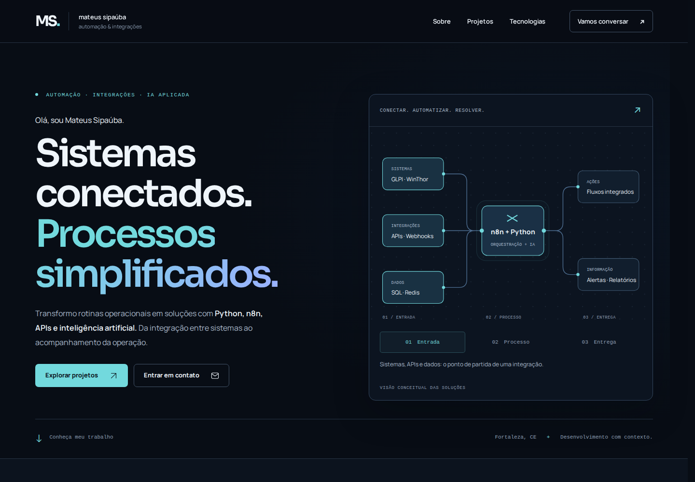

# Portfólio — Mateus Sipaúba

Portfólio em **Flask + Jinja, CSS e JavaScript nativos**, focado em automação, integrações e IA aplicada. Mantém a identidade azul-marinho/ciano/azul, os dez projetos originais e as URLs existentes. Não exige Node, banco de dados ou serviços externos para funcionar.

Redesign desenvolvido na branch `feat/portfolio-premium` e integrado à `main`. A publicação é controlada pelo fluxo de deploy do ambiente.



## O que mudou

- Hero com posicionamento objetivo, dois CTAs e um mapa conceitual interativo de integração. No celular, o mapa muda para etapas verticais legíveis.
- Uma única galeria: três destaques e sete projetos complementares, sem repetir cards. Busca por nome/tecnologia, filtros combináveis, contagem e estado vazio. A busca ignora acentos e mantém o estado na URL.
- Dez estudos de caso com contexto, funcionamento, contribuição, tecnologias e documentação. Conteúdo derivado dos dados já presentes no repositório, sem métricas ou experiências inventadas.
- Resumo rápido em `<dialog>`, com Escape, ciclo de Tab/Shift+Tab, fechamento pelo backdrop, rolagem interna e retorno de foco. O link principal continua abrindo a página do projeto.
- Navegação responsiva, seção ativa, skip link, foco visível e alvos de toque. Conteúdo e links funcionam sem JavaScript; movimento reduzido é respeitado.
- Tipografia, espaçamento, tokens e componentes consistentes. As animações de entrada nunca deixam o conteúdo invisível.
- Fontes Manrope e Sora locais em WOFF2 com subconjunto latino, incluindo português, e licenças OFL. Ícones e diagramas vetoriais não dependem de bibliotecas ou imagens remotas.
- Metadados específicos por página, canonical, Open Graph, Twitter Cards, JSON-LD, sitemap, robots, favicons e imagem social personalizada de 1200 × 630.
- Assets CSS/JS/imagens com versão baseada no conteúdo e cache imutável quando a versão confere. Fontes locais usam preload e cache de um dia. CSP restrita à própria origem e demais cabeçalhos de segurança.
- `.dockerignore` evita incluir testes, screenshots e ferramentas de desenvolvimento na imagem de produção.

## Auditoria e decisões

A versão inicial (`d28f91c`) já usava Flask e Gunicorn, com duas dependências de produção. Não havia necessidade de migração de framework nem de um pipeline de frontend. Foram encontrados CSS acumulado com regras conflitantes e seletores sem uso, três projetos duplicados, três famílias de fontes externas, HTML comum repetido entre páginas e ausência de recursos essenciais de SEO/compartilhamento e testes.

A arquitetura foi preservada. A base visual foi consolidada, o layout compartilhado foi extraído para `base.html`, e cards, ícones e diagramas passaram a usar macros Jinja. CSS e JavaScript permanecem legíveis, sem bundle ou dependências de runtime adicionais. Os dez estudos de caso já existentes foram refinados e tornados acessíveis pela navegação principal dos cards.

Não havia currículo no repositório; nenhum arquivo ou link de currículo fictício foi criado. Os diagramas representam os fluxos documentados, sem simular telemetria de produção.

## Estrutura e manutenção

| Arquivo | Responsabilidade |
| --- | --- |
| `app.py` | Perfil, competências, rotas, metadados, cache e cabeçalhos |
| `projects.py` | Dez projetos, links, estudos de caso e fluxos conceituais |
| `templates/base.html` | Navegação, rodapé e metadados compartilhados |
| `templates/components.html` | Macros dos cards, ícones e diagramas |
| `templates/index.html` | Apresentação, galeria, tecnologias, contato e modal |
| `templates/project_detail.html` | Estudo de caso e projetos relacionados |
| `templates/404.html`, `templates/sitemap.xml` | Página de erro e sitemap |
| `static/style.css`, `static/site.js` | Design tokens, responsividade e interações |
| `static/fonts/` | Fontes locais e respectivas licenças |
| `static/images/social-card.png`, `static/favicon.*` | Assets de compartilhamento e identidade |
| `scripts/render_brand_assets.py` | Regeneração local da imagem social e dos ícones |
| `tests/test_app.py` | Contratos HTTP, conteúdo, links, SEO e cache |
| `tests/browser_check.py` | Navegador, seis resoluções, interação e acessibilidade |
| `docs/` | Capturas comparativas e evidências da validação |

Edite os textos técnicos em `projects.py` e os dados profissionais em `PROFILE`, `AREAS` e `STACK`, dentro de `app.py`. Preserve os slugs publicados. As URLs canônicas usam `SITE_URL`, nunca o cabeçalho Host recebido.

Os hashes dos assets são calculados na inicialização: reinicie os workers depois de alterar arquivos estáticos em produção. No desenvolvimento, use o modo debug do Flask. Alterações nas fontes devem preservar as licenças e o suporte aos caracteres de português.

## Executar localmente

Python 3.12 ou superior:

```bash
python3 -m venv .venv
source .venv/bin/activate
pip install -r requirements.txt
flask --app app run --debug
```

Acesse **http://127.0.0.1:5000**. Não são necessárias credenciais.

Para testar com o servidor de produção:

```bash
gunicorn --bind 127.0.0.1:5000 app:app
```

## Verificar a implementação

```bash
pip install -r requirements-dev.txt
python -m unittest discover -s tests -v
ruff check .
djlint templates --lint
python -m compileall -q app.py projects.py
python -m playwright install chromium
```

Com a aplicação rodando em outra sessão:

```bash
python tests/browser_check.py --base-url http://127.0.0.1:5000
```

O teste verifica a home e os dez estudos de caso em **360, 390, 768, 1024, 1440 e 1920 px**, filtros, busca, persistência na URL, menu mobile, foco, modal, navegação, ausência de overflow e erros de console. Também verifica os modos sem JavaScript e com movimento reduzido. Capturas e relatório são gravados em `test-results/`, ignorado pelo Git.

Para incluir axe, é possível instalar a ferramenta separadamente, sem alterar as dependências do site:

```bash
npm install --prefix /tmp/portfolio-audit axe-core
python tests/browser_check.py --base-url http://127.0.0.1:5000 \
  --axe-script /tmp/portfolio-audit/node_modules/axe-core/axe.min.js
```

A auditoria cobre regras automatizadas WCAG 2 A/AA, 2.1 A/AA, 2.2 AA e boas práticas na home, no modal aberto e em um estudo de caso, em desktop e mobile. Uma versão original rodando em outra porta pode ser registrada com `--baseline-url http://127.0.0.1:5001`.

A imagem social e os ícones podem ser regenerados com:

```bash
python scripts/render_brand_assets.py
```

A execução é local, determinística e sem chamadas de rede. Node/axe/Lighthouse são ferramentas opcionais de auditoria; não fazem parte da aplicação nem da imagem de produção.

## Validação realizada — 12/10/2026

- Oito testes de backend aprovados; lint Python e templates, sintaxe JavaScript e verificação do diff aprovados.
- Testes reais em Chromium 153 nas seis resoluções aprovados, inclusive as 60 combinações de estudo de caso/resolução.
- Nenhum overflow horizontal, erro de console ou falha de carregamento detectados na suíte final.
- Nenhuma violação automatizada do axe nos seis cenários auditados, incluindo contraste e correspondência entre rótulos visíveis e nomes acessíveis.
- Build do Dockerfile com Podman aprovado. A imagem Python 3.12 passou no smoke test de home, estudo de caso, sitemap e fonte local. Execução por Gunicorn também validada.
- Os dez links atuais de projetos e o perfil GitHub responderam HTTP 200.

| Página / perfil | Desempenho | Acessibilidade | Boas práticas | SEO | LCP | CLS | TBT |
| --- | --- | --- | --- | --- | --- | --- | --- |
| Home / desktop | 100 | 100 | 100 | 100 | 0.4 s | 0.024 | 0 ms |
| Home / mobile | 99 | 100 | 100 | 100 | 2.0 s | 0 | 80 ms |
| Estudo de caso / desktop | 100 | 100 | 100 | 100 | 0.4 s | 0 | 0 ms |
| Estudo de caso / mobile | 100 | 100 | 100 | 100 | 1.7 s | 0 | 0 ms |

Relatórios completos: [home desktop](docs/audits/lighthouse-home-desktop.html) · [home mobile](docs/audits/lighthouse-home-mobile.html) · [caso desktop](docs/audits/lighthouse-case-desktop.html) · [caso mobile](docs/audits/lighthouse-case-mobile.html).

Os números são medições de laboratório em **localhost com Gunicorn**, utilizando Lighthouse 13.5.0 e suas configurações de desktop/mobile. Não são medições do domínio de produção. INP de campo não foi medido; TBT não é um substituto para INP. Compressão de transferência depende da configuração do proxy de produção, que não foi alterada. É necessário medir novamente no domínio público depois da publicação autorizada.

Relatórios: [navegador e axe](docs/browser-report.json), [Lighthouse](docs/lighthouse-summary.json), [links externos](docs/links.json). As verificações automatizadas não equivalem a uma certificação completa de acessibilidade nem a testes em todos os navegadores e dispositivos reais.

Pendências externas: o redirecionamento legado `/projetos/automacao-sped-fiscal` foi preservado, mas seu destino `Sipauba/automacao_txt_sped_contabil` retorna 404 e não foi encontrado na lista pública de repositórios. Ele não aparece na galeria atual. É necessário confirmar com o proprietário o endereço público correto. O LinkedIn recusou a verificação automatizada via HEAD (405); a URL original de contato foi preservada.

## Antes e depois

| Visualização | Antes | Depois |
| --- | --- | --- |
| Desktop, 1440 px | [Captura completa](docs/images/before-1440.jpg) | [Captura completa](docs/images/after-1440.jpg) |
| Mobile, 390 px | [Captura completa](docs/images/before-390.jpg) | [Captura completa](docs/images/after-390.jpg) |
| Hero desktop | [Original](docs/images/before-hero-1440.png) | [Nova versão](docs/images/after-hero-1440.png) |
| Hero mobile | [Original](docs/images/before-hero-390.png) | [Nova versão](docs/images/after-hero-390.png) |

[Galeria](docs/images/projects-desktop.png) · [Projeto em destaque](docs/images/featured-project.png) · [Filtro ativo](docs/images/filtered-desktop.png) · [Estudo de caso](docs/images/case-desktop.jpg) · [Mapa mobile](docs/images/map-mobile.png)

## Publicar manualmente

O `Dockerfile` e o `Procfile` existentes continuam válidos. Para validar a imagem localmente, usando Docker ou substituindo o executável por Podman:

```bash
docker build -t portfolio-premium .
docker run --rm -p 127.0.0.1:5000:5000 -e PORT=5000 portfolio-premium
```

No EasyPanel, após revisar e autorizar a versão na `main`, solicite o deploy da aplicação existente conforme o fluxo configurado no ambiente. Ela continua escutando em `PORT` (padrão `5000`) com Gunicorn. Nenhuma alteração de domínio, DNS, infraestrutura ou credenciais é necessária para esta implementação.

Após publicar, verifique `/`, um estudo de caso, `/robots.txt`, `/sitemap.xml`, o compartilhamento social e as métricas no domínio público. O envio de código à `main` não confirma o resultado de um eventual deploy automático.
