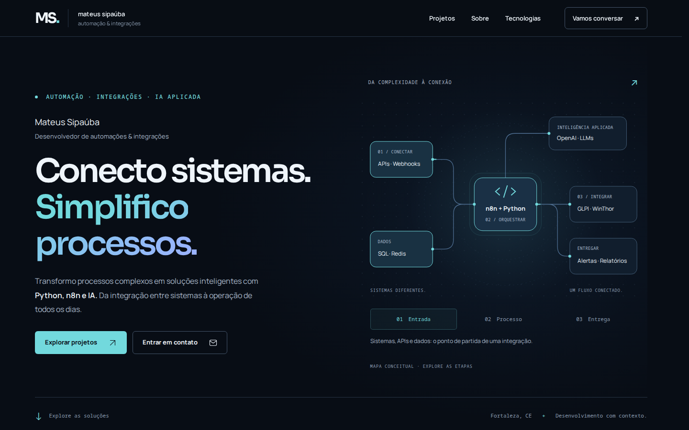

# Portfólio — Mateus Sipaúba

Portfólio em **Flask + Jinja, CSS e JavaScript nativos**, voltado a automação, integração de sistemas e IA aplicada. Preserva a identidade azul-marinho/ciano/azul, as informações profissionais, os dez projetos e suas URLs.

Esta evolução foi desenvolvida na branch **`feat/portfolio-premium-v2`**, a partir de `d180300`, com integração à `main` autorizada pelo proprietário. O envio do código pode acionar o deploy configurado no ambiente; não confirma, por si só, a publicação da versão. Não foram alterados DNS ou infraestrutura de produção.



## Auditoria e direção visual

A versão de partida já tinha um redesign funcional: fontes locais, metadados, estudos de caso, filtros, modal, testes e cache de assets. Esta revisão evolui essa base, sem introduzir outro framework ou dependências de produção. Os relatórios e as capturas anteriores permanecem em `docs/`; as evidências desta revisão estão em `docs/audits/v2/` e `docs/images/v2/`.

As três referências foram inspecionadas, assim como o site público. A direção incorpora hierarquia e espaço da [Linear](https://linear.app), detalhes de interação da [Raycast](https://www.raycast.com) e clareza de apresentação profissional de [Brittany Chiang](https://brittanychiang.com). Os diagramas são autorais e representam os fluxos documentados no repositório; não são painéis de operação nem métricas reais.

As principais lacunas encontradas foram a repetição visual dos diagramas, uma seleção de destaques diferente da solicitada e a oportunidade de apresentar os projetos mais cedo. A auditoria de performance também identificou um deslocamento causado pelo menu mobile ao inicializar o JavaScript; ele foi corrigido com CSS inicial estável e um fallback específico para navegação sem JavaScript.

## O que mudou nesta revisão

- **Hero:** nome e posicionamento explícitos, headline mais compacta, CTAs claros e mapa conceitual com APIs, dados, automação, IA e entregas. O mapa tem profundidade discreta e pulsos finitos na interação; adapta-se a etapas legíveis quando o espaço é reduzido.
- **Projetos primeiro:** cinco destaques na ordem Glados, Bot de Cobrança, Pinga ni Mim, GLPI/Admissão e Follow Up de Compras. Os outros cinco continuam em uma lista compacta. Todos mantêm estudo de caso, repositório e resumo rápido.
- **Diagramas próprios:** conversas e serviços no Glados; validação e controle de envio na cobrança; Ping/HTTP e alertas no monitoramento; retorno ao chamado de origem no GLPI; consulta e exportação no acompanhamento de compras.
- **Leitura dos casos:** navegação interna para contexto, solução/implementação e benefícios. Conteúdo técnico e resultados existentes preservados, sem inventar métricas, empresas ou experiências.
- **Competências:** categorias mais claras; SQL e Zabbix, já descritos na atuação profissional, aparecem também na seleção de tecnologias.
- **Acabamento:** navegação mais compacta, tokens ampliados, cartões com profundidade sutil, entradas dos projetos e estados consistentes de foco, hover e alto contraste. Respeita `prefers-reduced-motion`.
- **SEO e compartilhamento:** imagem social e descrição alternativa alinhadas à nova hero. Canonical, JSON-LD, sitemap, robots, metadados individuais e cabeçalhos de segurança continuam ativos.

A busca ignora acentos, combina categoria e termos, mantém o estado na URL e apresenta estado vazio. O modal conserva Escape, contenção e retorno de foco. Conteúdo, estudos de caso e links continuam acessíveis sem JavaScript. Não foi criado um currículo fictício: o LinkedIn existente continua sendo a referência de trajetória profissional.

## Design system e estrutura

Os tokens ficam no início de `static/style.css`:

| Papel | Valor |
| --- | --- |
| Fundo / superfície / superfície elevada | `#080d15` / `#101824` / `#151f2d` |
| Texto / texto secundário | `#eff5fb` / `#a9b8c9` |
| Acentos preservados | Ciano `#72d9dd`, azul `#7d9dff` |
| Fontes locais | Sora para títulos, Manrope para leitura, monospace para legendas |
| Espaçamento | 4, 8, 12, 16, 24, 32, 48 e 64 px; seções com escala fluida |
| Raios / transições | 6, 16 e 24 px; duração base de 200 ms |

| Arquivo | Responsabilidade |
| --- | --- |
| `app.py` | Perfil, competências, rotas, metadados, cache e cabeçalhos |
| `projects.py` | Projetos, conteúdo técnico, fluxos e ordem dos destaques |
| `templates/base.html` | Estrutura compartilhada, navegação, SEO e fallback sem JS |
| `templates/index.html` | Hero, projetos, atuação, tecnologias, contato e modal |
| `templates/integration_map.html` | Novo mapa conceitual da hero |
| `templates/project_visuals.html` | Novos diagramas e macro reutilizável de nós |
| `templates/components.html` | Ícones, cards e composição dos diagramas |
| `templates/project_detail.html` | Estudo de caso com navegação interna |
| `static/style.css`, `static/site.js`, `static/nojs.css` | Tokens, responsividade e interações progressivas |
| `scripts/render_brand_assets.py` | Imagem social e ícones, gerados localmente |
| `scripts/audit_performance.py` | Auditoria reproduzível com Lighthouse |
| `tests/` | Contratos HTTP, conteúdo, navegação, responsividade e acessibilidade |

Não há bundle de frontend, banco de dados ou serviço externo necessário para executar o site. As únicas dependências de produção continuam sendo Flask e Gunicorn. Fontes e diagramas são locais; Node, Playwright, axe e Lighthouse são ferramentas de desenvolvimento. O Dockerfile exclui testes, capturas e ferramentas da imagem de produção.

Edite dados profissionais em `PROFILE`, `AREAS` e `STACK`, em `app.py`; conteúdo e seleção em `projects.py`. Preserve slugs publicados. Reinicie os workers após mudanças em arquivos estáticos: a versão dos assets é calculada por hash na inicialização.

## Verificação desta revisão — 12/10/2026

- **9 testes de backend aprovados**, incluindo preservação de links, ordem dos destaques, navegação interna, SEO, cache e cabeçalhos.
- Ruff, lint Jinja, sintaxe JavaScript, formatação CSS/JS e verificação do diff aprovados.
- **Chromium 153** nas larguras **360, 390, 768, 1024, 1440 e 1920 px**: home, dez estudos de caso, busca, filtros, menu, modal, foco e mapa aprovados.
- Sem overflow horizontal, erros de console ou falhas de carregamento detectados.
- **Zero violações do axe** nos seis cenários: home, modal e estudo de caso, em desktop e mobile. Regras automatizadas WCAG 2 A/AA, 2.1 A/AA, 2.2 AA e boas práticas.
- Navegação sem JavaScript, movimento reduzido, alto contraste, navegação dos casos e reflow em 640 CSS px/DPR 2 verificados. Esse último cenário equivale ao espaço de layout de um desktop de 1280 px com zoom de 200%; não substitui todos os testes manuais de zoom.
- Regressão específica: atraso de 750 ms no carregamento do JavaScript não desloca o início do conteúdo ao inicializar o menu.
- Dockerfile construído com Podman; smoke test da imagem Python 3.12 aprovado para home, dez casos, sitemap, robots e fonte local. Servidor Gunicorn também utilizado nos testes de navegador.

| Página / perfil | Performance | Acessibilidade | Boas práticas | SEO | LCP | CLS | TBT |
| --- | --- | --- | --- | --- | --- | --- | --- |
| Home / desktop | 100 | 100 | 100 | 100 | 0.4 s | 0 | 0 ms |
| Home / mobile | 99 | 100 | 100 | 100 | 1.8 s | 0 | 0 ms |
| Estudo de caso / desktop | 100 | 100 | 100 | 100 | 0.4 s | 0 | 0 ms |
| Estudo de caso / mobile | 99 | 100 | 100 | 100 | 1.8 s | 0 | 80 ms |

Relatórios completos: [home desktop](docs/audits/v2/lighthouse-home-desktop.report.html) · [home mobile](docs/audits/v2/lighthouse-home-mobile.report.html) · [caso desktop](docs/audits/v2/lighthouse-case-desktop.report.html) · [caso mobile](docs/audits/v2/lighthouse-case-mobile.report.html).

A primeira rodada registrou CLS mobile de 0,141; a rodada final, após corrigir a inicialização do menu, registrou 0. O [resumo anterior à correção](docs/audits/v2/before-cls-fix.json) foi preservado.

As medições são de laboratório, em **localhost com Gunicorn**, usando Lighthouse 13.5.0, perfis padrão de desktop/mobile e uma execução por cenário na rodada final. **INP de campo não foi medido**; TBT não substitui INP. O domínio público precisa de nova medição após uma publicação autorizada. A verificação automatizada não representa uma certificação completa de acessibilidade ou cobertura de todos os navegadores e dispositivos.

Evidências: [navegador e axe](docs/audits/v2/browser-report.json), [verificações complementares](docs/audits/v2/supplementary-checks.json), [métricas Lighthouse](docs/audits/v2/summary.json) e [tamanhos/hashes de assets](docs/audits/v2/assets.json).

## Antes e depois

O “antes” foi capturado da revisão `d180300` no início desta tarefa, e não de uma versão antiga do portfólio.

| Visualização | Antes | Depois |
| --- | --- | --- |
| Hero desktop, 1440 px | [Antes](docs/images/v2/before-hero-1440.png) | [Depois](docs/images/v2/after-hero-1440.png) |
| Hero mobile, 390 px | [Antes](docs/images/v2/before-hero-390.png) | [Depois](docs/images/v2/after-hero-390.png) |
| Página completa, desktop | [Antes](docs/images/v2/before-1440.jpg) | [Depois](docs/images/v2/after-1440.jpg) |
| Página completa, mobile | [Antes](docs/images/v2/before-390.jpg) | [Depois](docs/images/v2/after-390.jpg) |

[Glados](docs/images/v2/glados.png) · [Cobrança](docs/images/v2/billing.png) · [Monitoramento](docs/images/v2/monitoring.png) · [GLPI](docs/images/v2/glpi.png) · [Compras](docs/images/v2/purchases.png) · [Estudo de caso](docs/images/v2/case-1440.jpg).

## Executar localmente

Python 3.12 ou superior:

```bash
python3 -m venv .venv
source .venv/bin/activate
pip install -r requirements.txt
flask --app app run --debug
```

Abra **http://127.0.0.1:5000**. Para usar o servidor de produção localmente:

```bash
gunicorn --bind 127.0.0.1:5000 app:app
```

## Reproduzir os testes

```bash
pip install -r requirements-dev.txt
python -m unittest discover -s tests -v
ruff check .
djlint templates --lint
python -m compileall -q app.py projects.py
node --check static/site.js
python -m playwright install chromium
```

Com o servidor local em outra sessão:

```bash
python tests/browser_check.py --base-url http://127.0.0.1:5000
```

Para incluir axe e Lighthouse, com Node instalado:

```bash
npm install --prefix /tmp/portfolio-audit axe-core@4.14.0 lighthouse@13.5.0
python tests/browser_check.py --base-url http://127.0.0.1:5000 \
  --axe-script /tmp/portfolio-audit/node_modules/axe-core/axe.min.js
python scripts/audit_performance.py --base-url http://127.0.0.1:5000 \
  --lighthouse /tmp/portfolio-audit/node_modules/lighthouse/cli/index.js
```

O script de performance aceita `--chrome` e `--node` para executáveis fora do PATH. Os relatórios ficam em `test-results/`, ignorado pelo Git. A imagem social pode ser regenerada com `python scripts/render_brand_assets.py`.

## Publicação após revisão

```bash
docker build -t portfolio-premium-v2 .
docker run --rm -p 127.0.0.1:5000:5000 -e PORT=5000 portfolio-premium-v2
```

Podman pode substituir Docker. Revise `git diff` na branch, registre as alterações em commit e siga o fluxo de revisão/merge do repositório antes de publicar. Não envie diretamente para `main` sem essa revisão: pode existir deploy automático associado à branch de produção.

No EasyPanel, use a aplicação e o fluxo de deploy existentes após a revisão e autorização. O `Dockerfile` e o `Procfile` permanecem compatíveis; Gunicorn escuta em `PORT`, com padrão 5000. Esta implementação não exige mudanças em DNS, servidores ou credenciais.

Depois da publicação, confira `/`, os estudos de caso, `/robots.txt`, `/sitemap.xml`, compartilhamento social e métricas no domínio público. Os redirecionamentos legados foram preservados; o destino antigo de `automacao-sped-fiscal`, apontado como indisponível na auditoria anterior, continua dependendo da confirmação do endereço correto pelo proprietário.
